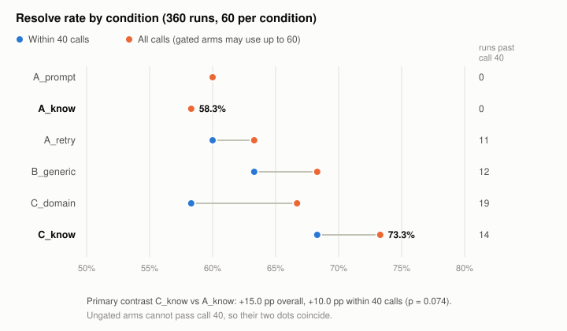
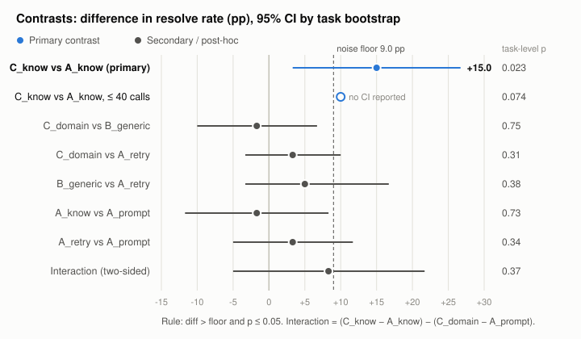
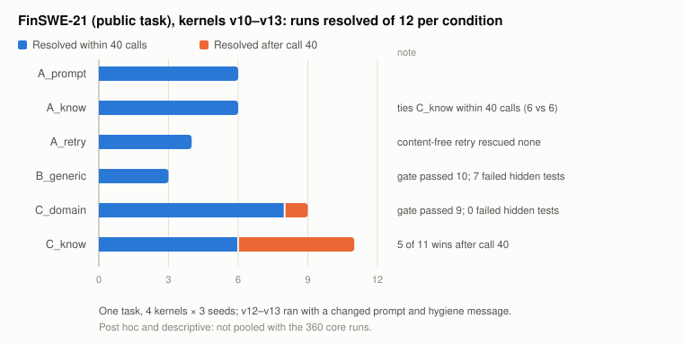
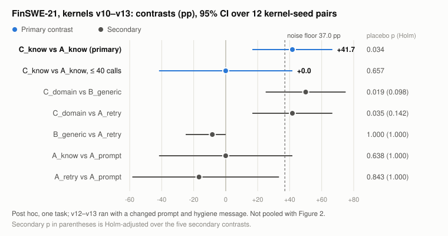

# Knowing Is Not Enforcing

**A pre-registered study of submission-time domain gates for a self-hosted Gemma 4 coding agent, on live-trading and open-source tasks**

Google — The Gemma 4 Developer Agent Paper Track
Hackathon Writeup · Oct 17, 2026 · Revised Oct 30, 2026

---

## Abstract

Coding agents built on open models are often told the domain rules a correct patch must obey, yet ship patches that break them. We ask whether checking those rules executably at submission time, and returning structured feedback, makes a fixed, self-hosted model more reliable. We introduce **FinSWE-Constraint**: 20 repository-level tasks from a Python trading bot that runs against a real brokerage account, plus one public task derived from an open-source trading agent. Ten tasks reproduce bugs from live operation where code compiled and passed its unit tests but broke a domain invariant. Seven are injected or latent bugs, and three are operational controls with no domain invariant. Holding the model (Gemma 4 31B QAT W4A16), base budget and harness fixed, we compare six conditions over 3 seeds (360 runs). Gated conditions add structured feedback and up to 20 extra tool calls after a rejected submission. The pre-registered primary contrast, invariants stated and gated (C_know) vs invariants stated only (A_know), shows 73.3% vs 58.3% hidden-test resolution (+15.0 pp, 95% CI +3.3 to +26.7), and holds under a task-level exact permutation test (one-sided p = 0.023, 20 task clusters). The gain is not robust to equalising the call budget (+10.0 pp, p = 0.074), and an audit traces at most 4 of the 11 C_know-only wins to a domain repair; stating invariants alone (A_know vs A_prompt) and domain versus generic feedback (C_domain vs B_generic) were both indistinguishable from zero. The knowing × enforcing interaction is not established (+8.3 pp, p = 0.37). In a within-run counterfactual on one seed, gate feedback turned 2 of 20 failing first submissions into resolved ones and worsened none; a content-free retry turned none. On a public task reconstructed from a look-ahead leak in TradingAgents (72 post-hoc runs over four kernels), every patch that passed the domain gate also passed the hidden tests (20 of 20), while the generic gate passed 7 patches that failed them; the stated-and-gated arm's extra wins there all came after the base 40 calls. We also document three interface failure modes that affected outcomes more than any condition did: argument double-escaping, scratch-file pollution, and test coupling.

---

## 1. Introduction

Throughout, *self-hosted* means an open-weight model served inside the agent's own runtime (here, one Kaggle instance with 4× NVIDIA L4 data-center GPUs) rather than a frontier API. Such a model reasons less well than frontier systems, but it can be surrounded by cheap, deterministic checks. Agents already receive rules in their prompts: "compile after editing", "do not leave scratch files", "do not look ahead". Our starting observation is that instructions are soft. In one pilot, agents were told to keep scratch files in `/tmp`, yet left `repro.py` in the repository in 6 of 7 tasks.

In finance, code can run, pass unit tests, and still be wrong. This is not peculiar to our codebase. In TradingAgents (TauricResearch; about 118k GitHub stars on 2026-10-30), a historical v0.7.0 run of PHM dated 2024-07-03 had its fundamentals analyst call `get_income_statement(curr_date="2024-07-3")`. The tool's `as_of` clamp passed the model's date through unchanged because it was not later than the run date, and the SEC EDGAR vendor compared filing dates as text (`"2024-07-23" > "2024-07-3"` is false). The run was served the Q2 10-Q filed on 2024-07-23 (net income $809M), and those figures appeared in its final Buy decision. The leak was reported on 2026-10-22, in a comment on PR #1488. That PR had been opened for a different symptom of the same unpadded date (FRED rejecting it with HTTP 400), and its full suite run reported 1,268 passing tests. The fix makes `as_of` and `as_of_window` return dates as `YYYY-MM-DD` (commit a5b0f21) and shipped in v0.7.1 on 2026-10-27. The project *knew* the rule, since the `as_of` clamp already existed, but no check fed it a date the code accepts yet does not compare correctly. Our own incident set contains the same pattern: a backtest that peeks one bar ahead, a "sell" that bypasses a protected position.

We study the gap between knowing a rule and having it enforced. Contributions:

1. **A benchmark of domain-constrained repair tasks with provenance.** Most tasks reproduce real incidents, and each ships two disjoint check sets: feedback verifiers the gate runs, and hidden tests used only for scoring. One additional task is derived from a public Apache-2.0 repository so that at least one task is independently verifiable.
2. **A pre-registered comparison of gate policies with placebo arms**, re-analysed at the task level, with a budget sensitivity analysis and a within-run counterfactual that removes between-run sampling noise.
3. **Measured interface failure modes of self-hosted SWE agents** (argument escaping, hygiene, evaluation coupling), each of which could silently invalidate an agent comparison, and how we detected and neutralised them.

---

## 2. Related work

SWE-bench (Jimenez et al., 2024) scores a repository patch by running issue-specific tests; SWE-bench Verified (OpenAI, 2024) human-filtered tasks with under- or over-specified tests. A later audit (OpenAI, 2026) found that at least 59.4% of an audited hard subset still had tests rejecting functionally correct fixes, alongside training contamination, and stopped reporting the benchmark. We met the same failure at small scale (Section 3.3). Our core tasks come from a private codebase, which limits contamination but also limits public verification (see Reproducibility). SWE-agent (Yang et al., 2024) showed that the agent-computer interface changes outcomes as much as the model. Our escaping finding is an instance of this. Test- and execution-based feedback for code generation is established (CodeRL, Le et al., 2022; Self-Debugging, Chen et al., 2024), as is iterative refinement (Self-Refine, Madaan et al., 2023; Reflexion, Shinn et al., 2023). Intrinsic self-correction without external signal is unreliable (Huang et al., 2024), so we include a content-free retry arm. A recent systematisation (Wang & Saxena, 2026) evaluates 15 academic LLM trading schemes, TradingAgents among them, for robustness and security, including attacks on the information sources an agent reads. The look-ahead class we benchmark concerns the same input channel, with no adversary: the agent's own data path serves information it should not have. Our focus is domain invariants that ordinary unit tests do not cover, and whether stating them is enough.

---

## 3. The FinSWE-Constraint benchmark

### 3.1 Source system

The source is a private Python trading bot for the Toss Securities Open API. At benchmark commit `c4c05ea` it has 5,538 lines of package source and 263 offline unit tests in 3,475 lines of test code (counted with `wc -l` over `*.py` and `def test_`). It covers a rule engine, an LLM advisor, news ingestion, a paper broker, backtesting and self-revalidation. Every task snapshot is sanitized: the live order adapter and all order endpoints become stubs that raise, and tests exercising them are removed. Gold patches and hidden tests are re-derived as diffs between sanitized trees, so no task depends on the live path.

### 3.2 Tasks (20 core + 1 public)

| Provenance | n | Examples (invariant) |
|---|---|---|
| Live incident | 10 | AI-only SELL must not close a protected core holding; covered-call ETFs are never trend-sold; a symbol is open only in sessions where it trades; candle requests ≤ 200 bars |
| Injected / latent / dev-found | 7 | no look-ahead in backtests; fees on both legs; `parse_headlines(now=T)` drops items published after T (latent in the current code); no same-day re-buy after take-profit |
| Control (ops) | 3 | quiet Ctrl+C exit; monitor survives a network error; closed-market log not repeated |
| Public (external incident) | 1 | a historical run dated D must not receive a filing filed after D, even when D is unpadded (TradingAgents #1488) |

Incident tasks come from fix commits. Two needed reconstruction because the buggy state was never committed: we re-inject the bug with a `bug.patch` and write hidden tests by hand. Two more were isolated from bundled commits. For injected tasks, visible tests that would reveal the bug move to the hidden set.

**Public task FinSWE-21.** All 360 experimental runs in Section 5 use the 20 core tasks only. FinSWE-21 was added after the experiment and is released as a verifiable specimen of the task format. Its 72 runs (six arms × 3 seeds in each of four kernel runs) are reported separately in Section 5.4 and are not pooled with the 360. Its hidden tests are behavioural and run through the tool the analyst calls, so a fix in the date layer (upstream's) and a fix in the vendor comparison both resolve the task. No hidden test calls the vendor's internal `_as_of` directly. Upstream's own fix leaves that function unchanged, so such a test would reject a correct fix: the over-specification of Section 3.3.

```text
Task FinSWE-21 (public; TradingAgents, Apache-2.0, base e8f5503 = v0.7.0; id PUB-21)
Issue      : a run dated 2024-07-03 is served a 10-Q filed 2024-07-23 when the model
             passes curr_date "2024-07-3"
Base bug   : as_of() returns the model's date string unchanged when it is not later than
             the run date; sec_edgar._as_of then tests fact["filed"] > as_of_date as text
Gold       : upstream a5b0f21, date_window.py only: as_of / as_of_window return YYYY-MM-DD
             (the commit's create_run_state check guards another entry point; not in scope)
Hidden F2P : run 2024-07-03, curr_date "2024-07-3" / "2024-7-3" / "2024-7-03", through the
             get_income_statement tool -> Q2 figure (filed 07-23) absent
Hidden P2P : padded curr_date unchanged; Q1 figure filed 2024-04-23 still served
             (anti-gaming: "exclude everything" fails); the repository's own suite
Verifier   : other filer, balance sheet, run 2025-03-07; amendments filed 03-05, 03-07,
             03-28; curr_date "2025-3-7" and "2025-03-7" must serve the 03-07 amendment and
             never the 03-28 one; padded boundary probe (filed on the run date is served)
```

Validation: `public_task.py build` reports the task valid. Of the 1,366 tests that ran at base and with gold, all 3 FAIL_TO_PASS tests fail at base and pass with gold, the other 1,362 pass on both sides (PASS_TO_PASS), and none fails with gold. The domain verifier flags base and passes gold (`verify.py selftest`).

### 3.3 Making scoring measure behaviour

Every FAIL_TO_PASS test fails at base, and every hidden test passes with gold (20/20). An audit then found tests that scored style rather than correctness: assertions on Korean log wording, and one assertion on a private helper's return value. In a pilot, every condition failed that task while implementing the required behaviour at the public entry point. We rewrote these as behavioural tests (e.g. frozen-clock checks of the public market-hours gate) and kept the originals for provenance. After rewriting, 5 of 6 previously failing patches resolve. Anti-gaming tests make a patch fail when it disables a feature to satisfy a constraint (e.g. shortening a look-back to obey the 200-bar cap).

### 3.4 Feedback verifiers

Each non-control task has a domain verifier: 2–4 executable checks that report *scenario / expected / observed*. Verifiers never run hidden tests or reuse their fixtures. They use different symbols, dates, thresholds and boundary probes. Each verifier flags the base and passes gold (selftest, 17/17 non-control tasks).

For income-ETF tasks, synthetic prices use an index-linked monthly distribution sawtooth calibrated on JEPQ vs QQQ, 2022–2026 (51 distribution dates, 50 with a computable ex-day return):

| Statistic | Synthetic | Actual |
|---|---|---|
| beta | 0.715 | 0.717 |
| daily correlation | 0.961 | 0.962 |
| ex-day return | −0.90% | −0.91% |

One scenario has an ex-dividend drop cross EMA50 while the index stays healthy, as in 4 of 7 real ex-day EMA50 breaks. A trend rule sells; the correct rule holds.

A pilot exposed verifier under-specification: one verifier passed a patch that failed the hidden test because its risk config was laxer than the repository default. After the fix, no run that passed the domain gate failed the hidden tests (0 of 102 non-control C_domain/C_know runs). Under the generic gate alone, 7 of 51 passing runs still failed.

**Verifier design rule (post-hoc).** The TradingAgents incident is a verifier under-specification of the same kind: a clamp existed, but no check fed it a malformed-yet-accepted input. We therefore adopt, for every time-ordering verifier: (i) canonicalise inputs before comparing — parsed dates, never strings; (ii) probe the boundary from both sides with inputs the code accepts but did not anticipate (unpadded dates, timezone-naive timestamps, an item dated exactly on T). Re-auditing the two time-ordering verifiers found one gap in each, so we added two probes. The news verifier used only UTC timestamps, and a patch that compares naive wall-clock times passed both of its checks; D-PIT-3 now feeds pubDates one minute either side of T in +09:00 and −05:00. The backtest verifier's synthetic bars have open = close, so a fill at the next bar's close could not be told from the correct fill at the next bar's open; D-LOOK-3 gaps every open above its close. The 360 runs in Section 5 used the original verifiers. The selftest was then re-run on the private source: every verifier flags its base and passes gold. One INJ-02 run aborted with an interpreter segmentation fault unrelated to the task and passed on rerun.

---

## 4. Experimental setup

**Model and serving.** `gemma-4-31b-it-qat-w4a16-ct` (the competition model) on one Kaggle 4×L4 instance. vLLM 0.19.1 is launched through the competition's `adk_submission.VllmServer` with the gemma4 tool and reasoning parsers, 32k context, temperature 0.2, top-p 0.95, top-k 40, and thinking off.

**Agent loop.** A single agent with the harness's tool semantics (`run_command`, `read_file`, `edit_file`, `write_file`, `get_status`, `submit_patch`), 5,000-character outputs, a 150-line read cap and three continuation nudges. Editing uses the harness's own engine (`swegemma.edit.apply_replacement`). The system prompt is a public competition baseline, identical across conditions.

**Conditions and budget.** All arms start with 40 tool calls and a 12-minute clock (never extended). A rejected submission adds 10 calls.

| Arm | Invariants stated | At `submit_patch` | Max calls |
|---|---|---|---|
| A_prompt | – | accept | 40 |
| A_know | ✓ | accept | 40 |
| A_retry | – | one content-free "re-check" bounce | 50 |
| B_generic | – | syntax, hygiene, visible-test regressions; ≤ 2 bounces | 60 |
| C_domain | – | B + domain verifier; ≤ 2 bounces | 60 |
| C_know | ✓ | B + domain verifier; ≤ 2 bounces | 60 |

Contrasts therefore compare *gate policies* (feedback plus extra calls and attempts), not feedback alone. A_retry controls for one extra attempt but not for a second round. The `*_know` brief is generated from the verifier itself (title / scenario / expected, never observed), so A_know knows exactly what C_know checks.

**Pre-registered analysis** (fixed before multi-seed runs):

- A heuristic noise floor, 1.96 · sd_pooled · √(2/n_seeds) over per-seed resolve rates. It is a decision threshold, not a formal minimum detectable effect.
- A paired label-swap permutation within (task, seed), 2,000 Monte Carlo draws.
- "X beats Y" requires diff > floor and p ≤ 0.05. The single primary contrast is C_know vs A_know; secondary contrasts are Holm-adjusted.

**Post-hoc analyses** (deviations, reported as such). The pre-registered permutation treats 60 task-seed pairs as exchangeable, but the three seeds of a task are repeated measures. We therefore add an exact sign-flip permutation over 20 task-level differences (each averaged over seeds) and the interaction contrast (C_know − A_know) − (C_domain − A_prompt). We also add a budget sensitivity analysis that scores a run as failed if it resolved after call 40.

**Outcome.** A run is *resolved* when the agent's patch plus the hidden tests pass all FAIL_TO_PASS and PASS_TO_PASS tests in a fresh snapshot. P2P tests that fail at base in the offline image (one needs an optional SDK) are excluded and recorded. For seed 2, each gated run's first submitted patch is also scored.

---

## 5. Results

### 5.1 Between-condition (3 seeds, 360 runs)

| | A_prompt | A_know | A_retry | B_generic | C_domain | C_know |
|---|---|---|---|---|---|---|
| Resolved | 60.0% | 58.3% | 63.3% | 68.3% | 66.7% | 73.3% |
| Resolved within 40 calls | 60.0% | 58.3% | 60.0% | 63.3% | 58.3% | 68.3% |
| Runs using > 40 calls | 0 | 0 | 11 | 12 | 19 | 14 |
| Resolved after call 40 / runs past call 40 | – | – | 2 / 11 | 3 / 12 | 5 / 19 | 3 / 14 |



*Figure 1. Resolve rate per condition (60 runs each), within 40 calls (blue) and with all calls (orange). The extra calls a gate grants account for 5.0 of the 15.0 pp gap between C_know and A_know.*

| Contrast | Diff (pp) | 95% CI (task bootstrap) | Pre-reg. p (60 pairs) | Task-level exact p | Verdict |
|---|---|---|---|---|---|
| **C_know vs A_know (primary)** | +15.0 | +3.3, +26.7 | 0.015 | 0.023 (+9/−2 tasks) | beats (pre-reg. rule) |
| same, ≤ 40 calls | +10.0 | – | – | 0.074 (+7/−2) | not significant |
| C_domain vs B_generic | −1.7 | −10.0, +6.7 | 0.81 | 0.75 | below floor |
| C_domain vs A_retry | +3.3 | −3.3, +10.0 | 0.34 | 0.31 | below floor |
| B_generic vs A_retry | +5.0 | −3.3, +16.7 | 0.22 | 0.38 | below floor |
| A_know vs A_prompt | −1.7 | −11.7, +8.3 | 0.77 | 0.73 | below floor |
| A_retry vs A_prompt | +3.3 | −5.0, +11.7 | 0.35 | 0.34 | below floor |
| Interaction (two-sided) | +8.3 | −5.0, +21.7 | – | 0.37 | not established |

The noise floor is 9.0 pp (1.96 × 5.65% × √(2/3) = 9.04; pooled seed sd 5.65%, shown as 5.7% when rounded). p-values are one-sided unless marked. Secondary p-values are shown unadjusted; all remain > 0.05 after Holm correction, so adjustment does not change any verdict. The detector flagged 0 of 360 runs for accessing benchmark paths (see Section 6).



*Figure 2. Contrasts with task-bootstrap 95% CIs; the dashed line is the pre-registered noise floor. Only the primary contrast clears it, and its 40-call version does not reach p ≤ 0.05.*

C_know outperformed A_know under the pre-specified rule, and the task-level re-analysis agrees. The difference is not separable from the extra budget. The +15.0 pp gap is 9 runs: 11 C_know-only wins (8 in seeds 0–1, 3 in seed 2) against 2 A_know-only wins (1 in seeds 0–1, 1 in seed 2). Of the 11 C_know-only wins, 3 used more than 40 calls; with wins capped at 40 calls, the effect drops to +10.0 pp and is no longer significant. The last row of the first table shows the marginal yield of the extra budget directly: across gated arms, 13 of 56 runs that crossed call 40 went on to resolve (23%), with no arm above 27%. Stating invariants without a gate had no detectable effect (A_know ≈ A_prompt). Domain feedback was not distinguishable from generic feedback (C_domain ≈ B_generic).

### 5.2 Within-run counterfactual (seed 2)

| Gated arm | First ✗ → final ✓ | First ✓ → final ✗ |
|---|---|---|
| A_retry (content-free) | 0 / 20 | 0 / 20 |
| B_generic | 1 / 20 | 0 / 20 |
| C_domain | 2 / 20 | 0 / 20 |
| C_know | 2 / 20 | 0 / 20 |

In seed 2, 2 of 20 C_know runs improved after gate feedback, and none worsened in this sample; the one-sided 97.5% Clopper–Pearson upper bound on the worsening rate is 16.8% (1 − 0.025^(1/20)). C_know and A_know had equal first-submit resolve counts (13/20), so the seed-2 gap equals the gate's improvements. An audit of seeds 0–1 (first patches not stored) attributes 2 of 8 C_know-only wins to domain repairs, 5 to hygiene-only bounces that left an already domain-clean fix unchanged, and 1 to a first-pass success. Pooling seed 2 with that audit, at most 4 of 11 C_know-only wins are attributable to domain feedback; the remainder are hygiene bounces or sampling. Between-run differences therefore mix the intervention with sampling noise. We recommend within-run counterfactuals with budget-matched continuations (Section 6) as the primary measure in agent studies.

### 5.3 Where self-hosted agents actually fail

- **Tool-argument escaping.** With the gemma4 parser, 62% of edit/write calls arrived one JSON-escaping level too deep (literal `\\n`, `\\"`), and only 20% of exact-match edits succeeded. Replaying 301 failed edits through an unescape step recovered 57%. After adopting the harness's resilient engine, resolution on a 7-task pilot rose from 14–29% to 29–57%, larger than any condition effect. Parser-damaged calls remain frequent: per 60 runs, ungated arms logged 175–254 parser-damaged calls and gated arms 320–369, growing with the extra turns a gate adds.
- **Hygiene masks emptiness.** The agent writes `repro.py`, never applies its source edit, and is bounced for the stray file. It deletes the file and only then learns the patch is empty.
- **Feedback ignored.** Some bounces are answered by resubmitting unchanged code.
- **Evaluation coupling and environment drift** (Section 3.3). One P2P test needed an SDK absent offline, which made every regression gate unsatisfiable. Regressions are now judged relative to base failures in the same environment.

### 5.4 Public task FinSWE-21 (four kernel runs, 72 runs, not pooled with Section 5.1)

FinSWE-21 ran in four Kaggle kernels with the same model, budget, six arms and seeds 0–2 (18 runs each, 72 in all, none contaminated). The harness changed between kernels:

- **v10:** identical to Section 4.
- **v11:** adds one missing package to the task's environment. The Kaggle image imports it at every interpreter start, and without it every Python command printed an error line. No agent-visible behaviour changed otherwise.
- **v12 and v13:** fix a contradiction found in v11. The prompt said scratch files belong in /tmp, but the file tools reach /workspace only. These kernels change one sentence of the system prompt and the hygiene message, and make the PUB-21 verifier quote the deciding row instead of a table tail. v13 also retries a request that overflows the 32k context and hints when a parser-damaged call is repeated verbatim.

v10 and v11 therefore match Section 4; v12 and v13 do not. The table gives each kernel separately, and its totals pool all four.

| Resolved (of 3) | A_prompt | A_know | A_retry | B_generic | C_domain | C_know |
|---|---|---|---|---|---|---|
| v10 | 1 | 2 | 0 | 0 | 3 | 3 |
| v11 | 2 | 2 | 1 | 1 | 1 | 3 |
| v12 | 2 | 1 | 1 | 0 | 2 | 3 |
| v13 | 1 | 1 | 2 | 2 | 3 | 2 |
| **All four (of 12)** | **6** | **6** | **4** | **3** | **9** | **11** |
| … of which within 40 calls | 6 | 6 | 4 | 3 | 8 | 6 |
| First submit ✗ → final ✓ | – | – | 0 | 0 | 6 | 5 |
| First submit ✓ → final ✗ | – | – | 0 | 0 | 0 | 0 |
| Passed the final gate, failed the hidden tests | – | – | – | 7 of 10 | 0 of 9 | 0 of 11 |



*Figure 3. FinSWE-21 across kernels v10–v13: runs resolved of 12 per condition, split by whether the win came within 40 calls. One task: descriptive only.*

All of this is post hoc and on one task, so we read it as description, not as a test. Applied mechanically to the 72 runs, with each kernel-seed pair as a seed, the pre-registered rule gives the following:

- **Primary contrast:** C_know vs A_know is +41.7 pp (5 runs resolved by C_know only, 0 by A_know only). This clears the 12-seed noise floor of 37.0 pp, with placebo p = 0.034. **Within 40 calls the two are tied, 6 vs 6**: every extra C_know win came after call 40. This is the budget confound of Section 5.1 in its sharpest form.
- **C_domain vs B_generic:** +50.0 pp (6 vs 0 discordant, mostly within 40 calls: 8 vs 3), which is the opposite of the null on the core tasks. It does not survive Holm adjustment (p = 0.098).



*Figure 4. FinSWE-21 contrasts over the 72 runs, with 95% CIs by bootstrap over the 12 kernel-seed pairs (one task, so the task bootstrap of Figure 2 does not apply). The primary contrast clears the 37.0 pp noise floor overall and is +0.0 pp within 40 calls. Post hoc; not comparable with Figure 2.*

What held in all four kernels:

- **The domain gate never passed a wrong patch.** All 20 runs that passed the domain gate also passed the hidden tests. The generic gate passed 10 B_generic patches, and 7 of them failed the hidden tests.
- **Gate feedback rescued, and never harmed.** In 11 runs, a C_domain or C_know first submission that would have failed was repaired after feedback. No first submission that would have passed was made worse. Neither the content-free retry nor generic feedback rescued any run.

In v10 we read the traces of every domain-gate bounce. Every flagged domain check but one ended in an exception raised by the agent's own new date parsing on the unpadded dates the checks feed it, not in an observed late filing. The one other flag was a plain violation, raised by an empty patch:

- **The exceptions:** `date.fromisoformat('2025-3-7')` raises `ValueError`; `datetime.datetime.strptime` under `from datetime import datetime` raises `AttributeError`. The gate returned the exception with the check's scenario and expected value. The `fromisoformat` attempt passed the repository's visible tests, and the three v10 B_generic patches that failed the hidden tests all contain it.
- **Fix location:** every passing v10 patch fixed the vendor's `_as_of` in `sec_edgar`, and none touched `date_window.py`, where upstream fixed the bug. Hidden tests that accepted only upstream's fix location would have scored those runs as unresolved, which is the over-specification Section 3.2 removed.

---

## 6. Limitations and threats to validity

- **Budget confound.** Gates add calls and attempts. The decisive design runs two continuations from the same first-submit state with identical extra calls and time: one gets verifier feedback, one gets content-free feedback. That design is prepared but not run, because the GPU quota was exhausted.
- **Hidden tests are not isolated from the agent.** They ship zlib+base64-encoded in the input dataset. `read_file` is confined to the workspace, but `run_command` is a general shell. Contamination is detected by a regex over commands, which a determined agent could evade. "0 flagged" is not proof of no access. A separate scoring container (as in the competition's own two-container design) would close this.
- **Scale.** One repository, 20 tasks, 3 seeds. Six tasks resolved in all 18 of their runs and one in none, so 13 tasks carry the signal. Counterfactuals exist for one seed only. The public task (FinSWE-21) shows that the bug class recurs outside our repository. Its 72 runs (Section 5.4) are post hoc, on one task and partly under a changed harness; they add no statistical power to Section 5.1.
- **Verifiers are hand-written and can be under-specified**, as one was. The TradingAgents incident shows the same failure in a widely used project. We report verifier–test disagreement as a first-class metric and adopt the design rule of Section 3.4.
- **Harness.** Our loop mirrors the competition harness but is not the official leaderboard runner. We use a single agent without adapters.

---

## 7. Conclusion

Under a pre-registered rule, a self-hosted Gemma 4 agent resolved more domain-constrained tasks when stated invariants were also enforced at submission (+15 pp). That gain cannot yet be separated from the extra calls a gate grants. At most 4 of the 11 runs behind it trace to a domain repair, and the knowing × enforcing interaction is not established. Within runs, gate feedback improved some first submissions and worsened none in our sample, while a content-free retry improved none. The largest reliability changes we observed came from the interface: argument encoding, hygiene, and evaluation coupling. Fixing these is a precondition for any meaningful agent comparison. On the public TradingAgents task, the domain gate passed no wrong patch in 72 runs, while the generic gate passed 7. That is one task, so it illustrates the mechanism rather than measuring it, and there too the gated arm's gain over stated-only came entirely after call 40. The TradingAgents look-ahead leak is the public version of our thesis. It sat behind an existing date clamp, in a suite whose run reported 1,268 passing tests: knowing an invariant, and even half-enforcing it, is not the same as probing the boundary where it breaks.

---

## Reproducibility

Everything below is in the repository ([olabi/finswe-constraint](https://github.com/olabi/finswe-constraint)) or attached to the Kaggle notebook `kmmmvs/finswe-constraint-pilot` (datasets `kmmmvs/finswe-pilot-data` and `kmmmvs/finswe-tradingagents-wheels`). The trading bot's source repository is private and is not released: core tasks ship as sanitized snapshots. The competition's harness source (`swegemma`, `adk-eval-core`) is not included; participants obtain it from Kaggle.

- **One command recomputes every table.** `python3 repro/reproduce.py` verifies the checksums, recomputes every number in Sections 5.1, 5.2 and 5.4 from the run records, compares each with the value printed here, and redraws Figures 1–4. All 139 values match. The post-hoc analyses of Section 4 (exact task-level sign-flip, interaction, 40-call cap) are defined in that script; the pre-registered ones are `pilot/analyze.py`.
- **Run records, with SHA-256.** The 360 core runs are in `results/core/v5`, `v6` and `v8` (seeds 0, 1, 2; one kernel version each). The core runs' trajectories are withheld with the gold patches, because a resolved run's patch is itself a solution; the run records keep every outcome, call count and gate round. The 72 FinSWE-21 runs are in `results/v10`–`v13`. `results/SHA256SUMS` covers every record and archive.
- **Environment lock.** `repro/environment.lock.json` records the kernel's Docker image digest, machine, model and dataset sources, every file of the three datasets, the 93 TradingAgents wheels with SHA-256, the Python, vLLM and git versions, and the source commits.
- **Tasks and harness.** `tasks/` holds the 20 core tasks and FinSWE-21. The core tasks' gold patches are withheld, so that the benchmark stays usable; FinSWE-21 ships its gold, which is upstream's public fix. `harness/` builds, gates and selftests the tasks; `pilot/` holds the runner, system prompt, notebook and analysis. FinSWE-21 rebuilds from the upstream Apache-2.0 repository with `harness/public_task.py`, without any private material.

## References

- Chen, X., Lin, M., Schärli, N., & Zhou, D. (2024). Teaching Large Language Models to Self-Debug. *ICLR 2024*.
- Google (2026). Gemma 4 model documentation. https://ai.google.dev/gemma/docs/core (accessed 2026-10-06).
- Google & Kaggle (2026). The Gemma 4 Developer Agent competition (model `gemma-4-31b-it-qat-w4a16-ct`; harness packages `swegemma`, `adk-submission`, `adk-eval-core`). https://www.kaggle.com/competitions/gemma-4-developer-agent (accessed 2026-10-06).
- Huang, J., Chen, X., Mishra, S., Zheng, H. S., Yu, A. W., Song, X., & Zhou, D. (2024). Large Language Models Cannot Self-Correct Reasoning Yet. *ICLR 2024*.
- Jimenez, C. E., Yang, J., Wettig, A., Yao, S., Pei, K., Press, O., & Narasimhan, K. (2024). SWE-bench: Can Language Models Resolve Real-World GitHub Issues? *ICLR 2024*.
- Le, H., Wang, Y., Gotmare, A. D., Savarese, S., & Hoi, S. C. H. (2022). CodeRL: Mastering Code Generation through Pretrained Models and Deep Reinforcement Learning. *NeurIPS 2022*.
- Madaan, A., et al. (2023). Self-Refine: Iterative Refinement with Self-Feedback. *NeurIPS 2023*.
- NVIDIA (2026). NVIDIA L4 Tensor Core GPU. https://www.nvidia.com/en-us/data-center/l4/ (accessed 2026-10-06).
- OpenAI (2024). Introducing SWE-bench Verified. https://openai.com/index/introducing-swe-bench-verified/
- OpenAI (2026, Feb 23). Why SWE-bench Verified no longer measures frontier coding capabilities. https://openai.com/index/why-we-no-longer-evaluate-swe-bench-verified/ (accessed 2026-10-06).
- Shinn, N., Cassano, F., Gopinath, A., Narasimhan, K., & Yao, S. (2023). Reflexion: Language Agents with Verbal Reinforcement Learning. *NeurIPS 2023*.
- Wang, M., & Saxena, N. (2026). SoK: Trading Agents or Market Crashers? Dissecting Robustness and Security Failures in Academic Financial LLM Trading Schemes. arXiv:2609.19705. https://arxiv.org/abs/2609.19705 (accessed 2026-10-30).
- TauricResearch (2026). TradingAgents PR #1488, "fix(dates): serve a readable date as YYYY-MM-DD, so FRED accepts it" (opened 2026-10-05; leak reported in comments 2026-10-22); fix commit a5b0f21, "fix(tools): hand vendors the model's dates as YYYY-MM-DD (#1488)"; v0.7.1 release, 2026-10-27. https://github.com/TauricResearch/TradingAgents/pull/1488 ; https://github.com/TauricResearch/TradingAgents/blob/v0.7.1/CHANGELOG.md (accessed 2026-10-30).
- Yang, J., Jimenez, C. E., Wettig, A., Lieret, K., Yao, S., Narasimhan, K., & Press, O. (2024). SWE-agent: Agent-Computer Interfaces Enable Automated Software Engineering. *NeurIPS 2024*.
